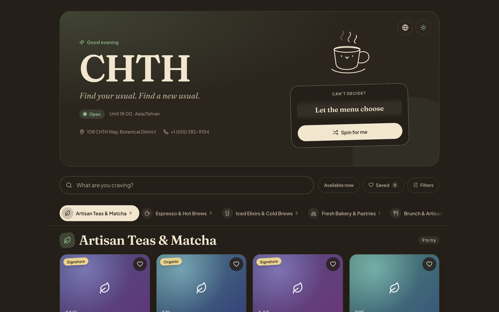
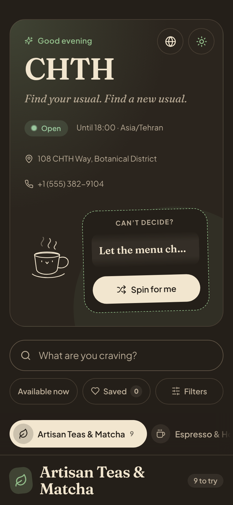
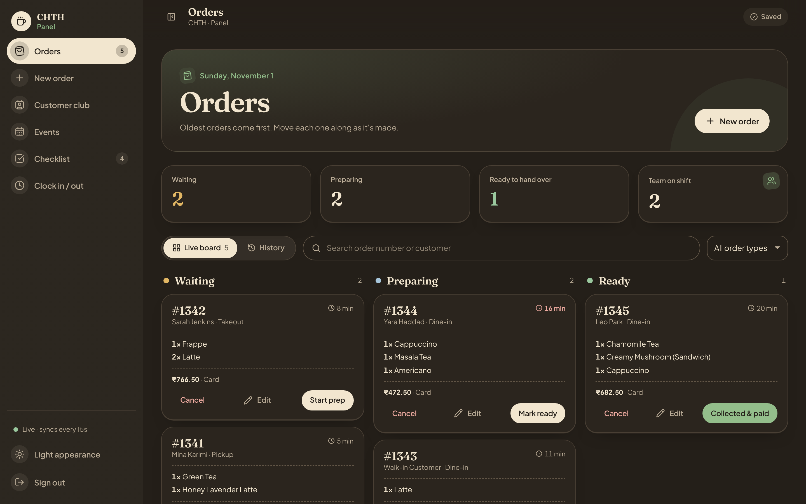
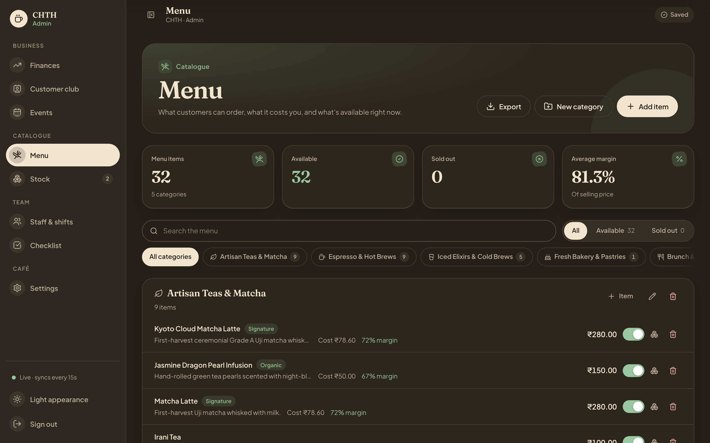
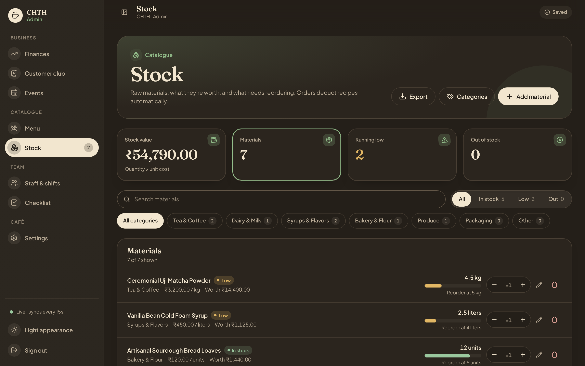

# CHTH Cafe

Cafe management with a public menu, staff workspace, and daily operations panel. Built with React, TypeScript, Tailwind CSS, and Hono on Cloudflare Workers, D1, and KV.

[](https://deploy.workers.cloudflare.com/?url=https://github.com/chethober/chth.cafe)

## Screenshots

Screenshots use the demo data from `schema.sql`.

**Public menu**

<p>
  
  
</p>

**Daily panel**: a live order board (waiting, preparing, ready), plus new orders, the checklist, and clock in/out.



**Admin workspace**: menu items with cost, margin, and availability, plus raw-material stock with low-stock alerts.





## Development

Requires Node.js 22+ and npm.

```bash
git clone https://github.com/chethober/chth.cafe.git
cd chth.cafe
npm install
npm run db:seed
npm start
```

`npm start` (or `npm run dev`) generates fresh random admin and panel passwords on every startup and prints both to stdout. It also rotates `SESSION_SECRET`, invalidating previous sessions and order tracking tokens. Credentials are saved in the Git-ignored `.dev.vars` with owner-only permissions; other local bindings are preserved.

Database seed staff credentials are random and demo staff PINs are unset; set staff PINs in the admin workspace before using clock actions.

Local apps:

- Menu: http://localhost:3000
- Admin: http://admin.localhost:3000
- Daily panel: http://panel.localhost:3000

Vite runs on port 3000 and proxies `/api` to the local Worker on port 8787. The startup scripts enable `CAFE_DEV_PROXY` locally to preserve the staff subdomain through Wrangler; do not enable this binding in deployment. Staff apps use their subdomains; because `wrangler.jsonc` sets `CAFE_WORKSPACE_PATHS`, they also open at http://localhost:3000/admin and http://localhost:3000/panel, as on workers.dev.

| Command | Purpose |
| --- | --- |
| `npm start` / `npm run dev` | Generate passwords and start the UI and Worker together |
| `npm run dev:ui` | Start only Vite |
| `npm run dev:worker` | Start only the local Worker (build first) |
| `npm run db:seed` | Initialize the local database from `schema.sql` |
| `npm run db:migrate:local` | Apply `backup.sql` to the local database |
| `npm test` | Run Worker/D1 integration, setup, control plane and release tests |
| `npm run check` | Check TypeScript types |
| `npm run build` | Check types and build production assets |
| `npm run release` | Build and package a versioned release for the control plane in `release/` |
| `npm run deploy:control-plane` | Package a release and deploy the control plane |

## Deploy

There are three ways to put a café online. Each café gets its own Worker, D1 database and KV namespace.

### One click from CHTH Café Cloud

The control plane in [`control-plane/`](control-plane/README.md) lets owners sign in with their own Cloudflare account (with Cloudflare's consent screen or an API token), with no separate account to create, and deploy or update a café with one click. The café runs in the owner's account; the control plane never sees its passwords.

### Deploy button

Use the button above to start the [Cloudflare deployment flow](https://developers.cloudflare.com/workers/platform/deploy-buttons/). Use `npm run deploy` as the deploy command, and enter any long random value for `SETUP_TOKEN` when asked. Wrangler creates the database and namespace, and the Worker creates its tables on first use. Then open `https://<worker>.<subdomain>.workers.dev/admin`, enter the setup code, and choose the admin and panel passwords.

### From the CLI

```bash
npx wrangler login
npx wrangler secret put SETUP_TOKEN
npm run deploy
```

`wrangler.jsonc` serves the café on workers.dev, with the admin at `/admin` and the panel at `/panel` (`CAFE_WORKSPACE_PATHS`). To use your own domain, add custom domain routes for the main domain and its `admin` and `panel` subdomains, and remove `CAFE_WORKSPACE_PATHS` so the staff apps stay on their subdomains. Keep that configuration in a Git-ignored `wrangler.production.jsonc` and deploy with `npx wrangler deploy -c wrangler.production.jsonc`.

To start with the demo menu instead of an empty café, run `npm run db:seed:remote` before the first visit.

Passwords chosen at setup can be changed later in **Settings → Sign-in**. Deployments that set `ADMIN_PASSWORD` and `PANEL_PASSWORD` as Worker secrets keep using them instead, and skip setup. `SESSION_SECRET` is optional: without it the Worker generates one and keeps it in D1.

Telegram notifications optionally use `TELEGRAM_BOT_TOKEN` and `TELEGRAM_CHAT_ID`. Set the cafe timezone and opening hours in Settings before accepting orders.

### Telegram bot

Add a bot token and chat ID in **Settings → Notifications** (or set `TELEGRAM_BOT_TOKEN` and `TELEGRAM_CHAT_ID`) to receive sales, shift, checklist and low-stock alerts. Pending orders arrive with buttons to start, finish or cancel them.

To manage the café from the chat, deploy over HTTPS and press **Connect bot commands**. That registers `/telegram/webhook` with Telegram, protected by a secret derived from `SESSION_SECRET`. Only the configured chat can use the commands; any other chat can only send `/chatid` to find its ID.

| Command | What it does |
| --- | --- |
| `/today` | Revenue, expenses, payment mix and top sellers so far |
| `/orders` | Open orders, with a button to move each one along |
| `/stock`, `/stock all` | Ingredients at or below their reorder level, or everything |
| `/restock milk 12` | Record a purchase in the ingredient's own unit |
| `/menu latte`, `/soldout` | Mark menu items sold out or back on |
| `/staff` | Who is clocked in, and for how long |
| `/tasks` | Open checklist tasks; tap to complete |
| `/expense 250 milk` | Log a cash expense for today |
| `/week`, `/report [YYYY-MM-DD]` | Last 7 days, or a full daily report (yesterday by default) |
| `/status`, `/alerts` | Open or closed now; turn each alert on or off |

The cron runs hourly. After midnight café time it sends yesterday's report, and from 09:00 it sends a low-stock check. Each runs once a day, tracked in KV.

## Languages

What customers see (the menu, ordering, order tracking, events and opening hours) and the
chth.cafe landing page come in English, Persian, Arabic, Russian and Spanish, with right-to-left
layout for Persian and Arabic. Guests pick a language from the menu's language picker or the
footer; otherwise it follows `?lang=`, the `chth_lang` cookie shared by CHTH sites, or the
browser. Customer strings live in `src/i18n/public.ts` (keyed by the English text, so a missing
translation shows English); the landing page's are in `control-plane/src/i18n.ts`. Menu items
are shown as the café wrote them. The admin and panel apps are English for now.

## CHTH kit and hub

`src/chth-kit/` is generated from the shared CHTH kit (brand tokens, logo, languages, product
links and the "Part of CHTH" footer shown under the public menu): don't edit it here. The control
plane can report landing visits from other CHTH products, sign-ins and deploys to a CHTH hub and
answer signed `GET /internal/stats`; set `HUB_URL` and `HUB_SECRET` to switch that on. Without
them nothing is sent and `/internal/stats` refuses every call. Self-hosted cafés send nothing.

## Contributing

See [CONTRIBUTING.md](CONTRIBUTING.md), [CODE_OF_CONDUCT.md](CODE_OF_CONDUCT.md), and [SECURITY.md](SECURITY.md).

[MIT License](LICENSE).

Admin and panel use separate passwords and sessions. Admin manages finances, menu, inventory, staff, and settings. Panel manages daily orders, menu availability, tasks, and clock actions; its API access cannot change admin settings or financial and staff records. Set `PANEL_PASSWORD` separately from `ADMIN_PASSWORD`.
